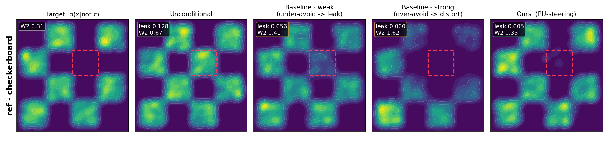
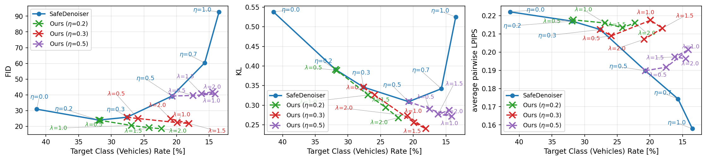
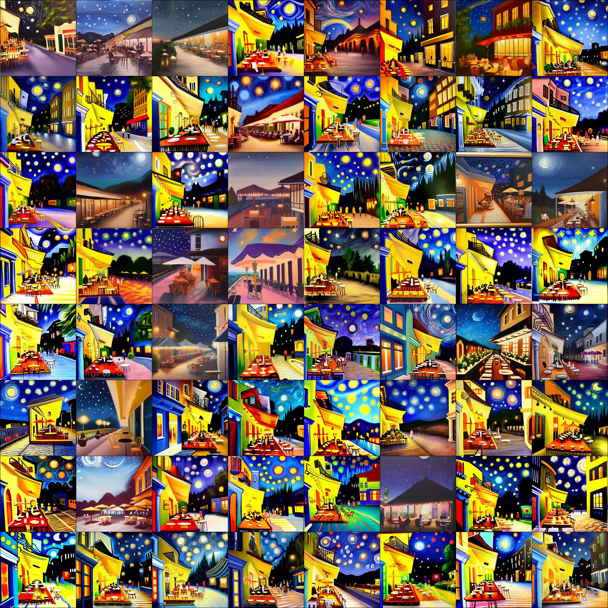
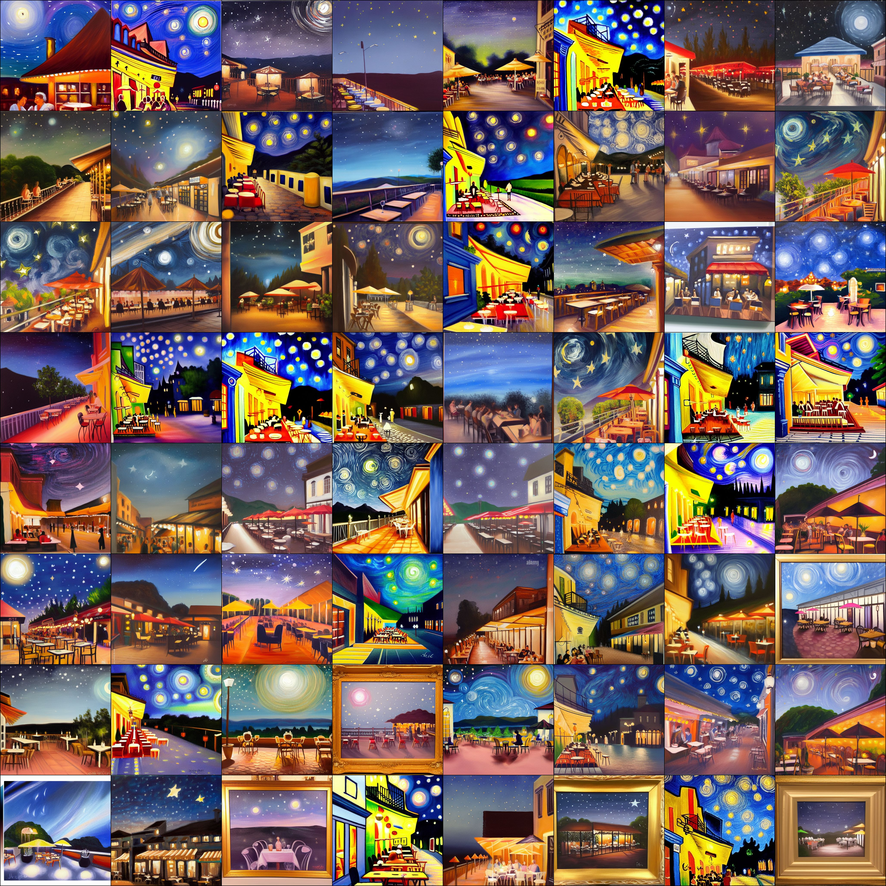

# Asymptotically Exact Negative Guidance of Diffusion Models via Positive-Unlabeled Learning

This repository contains four experiments on suppressing a specified class, style, mode, or spatial region in diffusion sampling.
Each experiment reports an avoidance metric and a distance or quality measure for the remaining target distribution.

The implementation and reproduction commands are documented in the README of each experiment.

## Experiments

### [`exp_checkerboard`](exp_checkerboard/)

Two-dimensional toy distributions provide the main visual demonstration.
The experiments remove modes from a ring mixture or a tile from a checkerboard while retaining the shape of the kept distribution.
The additional metrics are `leak` and the empirical 2-Wasserstein distance `W2`.

<p align="center"></p>

### [`exp_gmm`](exp_gmm/)

Three-dimensional twelve-component ring GMMs provide a controlled quantitative evaluation.
The score-based setting uses exact scores, and the reference-based setting uses samples from the avoided components.
The reported metrics are `post_mean`, `leak`, and the empirical 2-Wasserstein distance.

### [`exp_cifar10`](exp_cifar10/)

The CIFAR-10 experiment suppresses one class at a time or the vehicle group consisting of Plane, Car, Ship, and Truck.
It reports the avoided-class rate together with FID, KL, and mean pairwise LPIPS distance.

<p align="center"></p>

### [`exp_stable_diffusion`](exp_stable_diffusion/)

The Stable Diffusion v1.4 experiment generates the prompt "a cafe terrace at night under a starry sky" with less Van Gogh style.
It reports the style detection score, FID, KID, CSD-FD, and ESS/M for the weighted estimates.

<table align="center">
<tr>
<td align="center">SLD</td>
<td align="center">Ours</td>
<td align="center">NegCFG</td>
</tr>
<tr>
<td></td>
<td></td>
<td></td>
</tr>
</table>

## Citation

Hirohane Takagi and Masashi Sugiyama. Asymptotically Exact Negative Guidance of Diffusion Models via Positive-Unlabeled Learning. The 40th Annual Conference on Neural Information Processing Systems (NeurIPS2026), In Advances in Neural Information Processing Systems, **:****--****, 2026.

```bibtex
to be added
```
