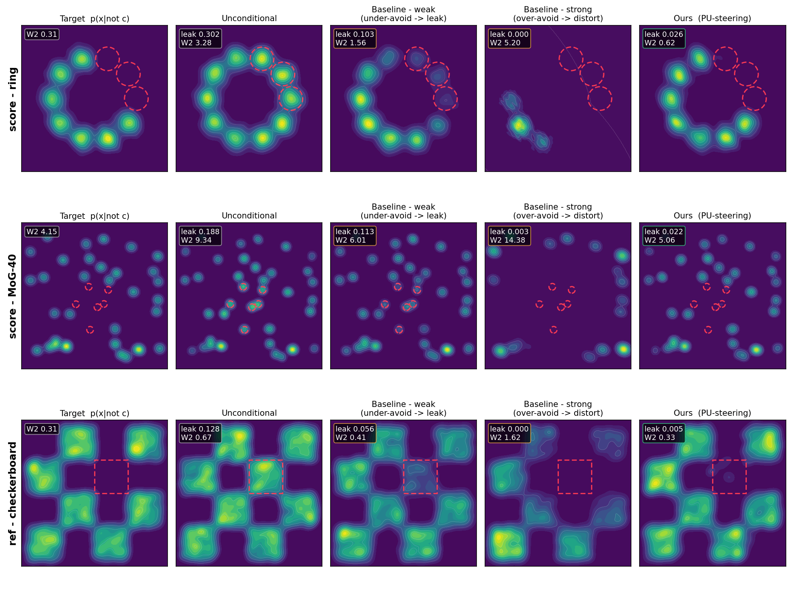

# 2D Visualizations of Negative Guidance

The main output is the figure below.



| setting | avoided region | score / reference | baseline |
|---|---|---|---|
| score - ring | three adjacent modes of a 10-mode ring | analytic score | DNG |
| score - MoG-40 | six modes in a 40-mode mixture | analytic score | DNG |
| ref - checkerboard | the central tile | learned unconditional score and avoided reference samples | SafeDenoiser |

Each row compares the kept target, the unconditional distribution, weak and strong baselines, and Ours. The figure also reports two auxiliary metrics: `leak`, the mass in the avoided region (posterior mass for the GMMs and weighted particle mass for the checkerboard), and `W2`, the empirical 2-Wasserstein distance to the kept target. Lower is better for both.

## Directory layout

- **`src/`**: Toy distributions, diffusion utilities, PU classifier, and samplers.
- **`runs/`**: Scripts for training, sampling, plotting, and parameter sweeps.
- **`figures/`**: Figures for the experiments.
- **`results/`**: Sampling caches and sweep results.
- **`ckpts/`**: The included checkerboard score checkpoint.

## Setup

Run the commands below from this directory. No GPU is required. The figures were generated with the following versions:

| package | version |
|---|---|
| Python | 3.14.3 |
| torch | 2.11.0 |
| numpy | 2.4.2 |
| scipy | 1.17.0 |
| POT | 0.9.6 |
| matplotlib | 3.10.8 |
| Pillow | 12.2.0 |

Create an environment and install the dependencies:

```sh
cd exp_checkerboard
python3 -m venv .venv
.venv/bin/python -m pip install --upgrade pip
.venv/bin/python -m pip install \
  torch==2.11.0 \
  numpy==2.4.2 \
  scipy==1.17.0 \
  POT==0.9.6 \
  matplotlib==3.10.8 \
  Pillow==12.2.0
```

## Train the checkerboard score

To retrain the checkerboard score from scratch:

```sh
.venv/bin/python runs/train_checker_score.py --threads 40
```

For a lightweight check, use fewer steps and write the checkpoint to a temporary path:

```sh
.venv/bin/python runs/train_checker_score.py --threads 1 --steps 200 --out /tmp/checker_score_check.pt
```

## Reproduce the main results

The included caches in `results/` were generated with 40 runs and 64 particles per run. To regenerate them:

```sh
.venv/bin/python runs/sample.py --threads 40
```

To generate one row only, pass its index (`0`: ring, `1`: MoG-40, `2`: checkerboard):

```sh
.venv/bin/python runs/sample.py 0 --threads 40
```

Use `--seeds` and `--M` to change the number of runs and particles. The baseline strengths can be changed with `--dng-weak`, `--dng-strong`, `--safed-weak`, and `--safed-strong`.

Render the panels and combine them into the main figure:

```sh
.venv/bin/python runs/make_panels.py
.venv/bin/python runs/combine.py
```

The panels are written to `figures/row_*.png` and the combined figure to `figures/demo_avoidance.png`.

## Quantitative evaluation

### DNG sweep

Sweep the DNG strength on the ring setting and print `leak` / `W2`:

```sh
.venv/bin/python runs/sweep.py \
  --setting ring \
  --strengths 1,2,3,5,8 \
  --seeds 8 \
  --threads 40
```

The smaller seed count makes this sweep faster but noisier than the main results.

### SafeDenoiser sweep

Sweep the SafeDenoiser strength and plot the `leak` / `W2` trade-off:

```sh
mkdir -p results/safed_frags
for eta in 1 2 3 4 5 6 7 8 10 12 16 24; do  # SafeDenoiser strengths eta
  .venv/bin/python runs/safed_sweep_point.py "$eta" 40 40 > "results/safed_frags/e${eta}.txt"  # eta, pooled runs, CPU threads
done
sort -n -k1,1 results/safed_frags/e*.txt > results/safed_sweep.tsv

# The marker coordinates below are leak/W2 reference values from the results caches.
.venv/bin/python runs/plot_safed_sweep.py results/safed_sweep.tsv \
  --ours 0.005 0.33 \
  --target 0.000 0.31
```

The plot is written to `figures/checker_safed_sweep.png`.

### Reference results

Reference values from the included caches:

| setting | Target | Unconditional | Baseline (weak) | Baseline (strong) | Ours |
|---|---|---|---|---|---|
| score - ring | 0.007 / 0.31 | 0.302 / 3.28 | 0.103 / 1.56 | 0.000 / 5.20 | 0.026 / 0.62 |
| score - MoG-40 | 0.000 / 4.15 | 0.188 / 9.34 | 0.113 / 6.01 | 0.003 / 14.38 | 0.022 / 5.06 |
| ref - checkerboard | 0.000 / 0.31 | 0.128 / 0.67 | 0.056 / 0.41 | 0.000 / 1.62 | 0.005 / 0.33 |
